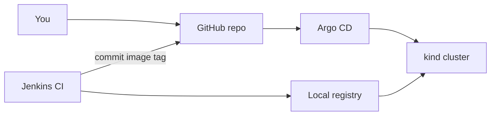

# gitops-tasks

A local lab for Docker, Kubernetes, Helm, Jenkins, and Argo CD. The app is a small Express task API. Jenkins is continuous integration. Argo CD is continuous delivery. Git is the source of truth for what the cluster runs.



Jenkins tests the app, builds an image, pushes `localhost:5001/tasks-api:<git-sha>`, and commits that tag in `charts/tasks-api/values.yaml`. Argo CD watches `main` and syncs the Helm chart into the `tasks` namespace. Jenkins never runs `kubectl apply`.

Deploy commits use the message `chore: deploy image <sha> [skip ci]` so the pipeline does not build the tag bump again.

## Layout

| Path | What it is |
| --- | --- |
| `src/` | Express API: `GET /health`, `GET /api/tasks`, `POST /api/tasks` |
| `Dockerfile` | Multi-stage Node 22 image |
| `k8s/` | Raw manifests, the step before Helm |
| `charts/tasks-api/` | Helm chart Argo CD deploys |
| `Jenkinsfile` | CI pipeline |
| `jenkins/` | Local Jenkins image, admin bootstrap, job definition |
| `argocd/application.yaml` | Argo CD Application |
| `scripts/kind-with-registry.sh` | kind cluster plus a registry on `localhost:5001` |

## Phase 0 — cluster and registry

```sh
export PATH="$HOME/.docker/bin:$HOME/.local/bin:$PATH"
./scripts/kind-with-registry.sh
kubectl cluster-info
```

The script publishes the task Service on [http://127.0.0.1:8080](http://127.0.0.1:8080). kind rewrites pulls of `localhost:5001/...` to the `kind-registry` container.

## Phase 1 — app and Docker

```sh
npm ci
npm test
docker build -t localhost:5001/tasks-api:dev .
docker push localhost:5001/tasks-api:dev
docker run --rm -p 3000:3000 localhost:5001/tasks-api:dev
```

`GET /health` returns `{"status":"ok","service":"tasks-api",...}`.

## Phase 2 — Kubernetes manifests

```sh
kubectl apply -f k8s/namespace.yaml
kubectl apply -f k8s/deployment.yaml -f k8s/service.yaml
kubectl -n tasks rollout status deploy/tasks-api
curl -sS http://127.0.0.1:8080/health
```

The Deployment sets readiness and liveness probes on `/health`, plus CPU and memory requests and limits. The Service is a NodePort on `30080`, which kind maps to host port `8080`.

## Phase 3 — Helm

```sh
helm lint charts/tasks-api
helm template tasks-api charts/tasks-api --namespace tasks
helm upgrade --install tasks-api charts/tasks-api --namespace tasks --create-namespace
curl -sS http://127.0.0.1:8080/health
```

`values.yaml` holds the image repository, image tag, replica count, resources, and probe timing. Before Argo CD takes over, uninstall this release so two controllers do not fight over the same objects:

```sh
helm uninstall tasks-api --namespace tasks
```

## Phase 4 — Jenkins CI

Jenkins runs in Docker on [http://127.0.0.1:8081](http://127.0.0.1:8081). The image adds Node 22, the Docker CLI, and the pipeline plugins. It mounts the Docker Desktop socket, so `docker build` and `docker push` use the host engine and can reach `localhost:5001`.

```sh
./scripts/run-jenkins.sh
```

- User: `admin`
- Password: the file printed by the script, `~/.config/gitops-tasks/jenkins-admin-password`
- GitHub credential id: `github` (your `gh` user and token, stored in Jenkins, not in git)

Create the Pipeline job once Jenkins is up. Keep the crumb and the POST in the same cookie jar, or Jenkins returns 403:

```sh
PASS="$(cat ~/.config/gitops-tasks/jenkins-admin-password)"
JAR="$(mktemp)"
CRUMB_JSON=$(curl -sS -c "$JAR" -b "$JAR" -u "admin:${PASS}" http://127.0.0.1:8081/crumbIssuer/api/json)
CRUMB=$(python3 -c 'import json,sys; print(json.loads(sys.argv[1])["crumb"])' "$CRUMB_JSON")
curl -sS -c "$JAR" -b "$JAR" -u "admin:${PASS}" -H "Jenkins-Crumb: ${CRUMB}" \
  -H "Content-Type: application/xml" \
  --data-binary @jenkins/tasks-api-job.xml \
  "http://127.0.0.1:8081/createItem?name=tasks-api"
curl -sS -c "$JAR" -b "$JAR" -u "admin:${PASS}" -H "Jenkins-Crumb: ${CRUMB}" -X POST \
  "http://127.0.0.1:8081/job/tasks-api/build"
```

A successful build pushes a new image and pushes a commit that changes `image.tag`.

## Phase 5 — Argo CD

```sh
kubectl create namespace argocd
kubectl apply -n argocd -f https://raw.githubusercontent.com/argoproj/argo-cd/stable/manifests/install.yaml
kubectl -n argocd rollout status deploy/argocd-server
```

Register the private repo (token is not stored in this repository):

```sh
kubectl -n argocd create secret generic gitops-tasks-repo \
  --from-literal=type=git \
  --from-literal=url=https://github.com/Codytm/gitops-tasks.git \
  --from-literal=username="$(gh api user --jq .login)" \
  --from-literal=password="$(gh auth token)"
kubectl -n argocd label secret gitops-tasks-repo argocd.argoproj.io/secret-type=repository
kubectl apply -f argocd/application.yaml
```

Argo CD UI password:

```sh
kubectl -n argocd port-forward svc/argocd-server 8443:443
kubectl -n argocd get secret argocd-initial-admin-secret -o jsonpath='{.data.password}' | base64 -d; echo
```

Log in at [https://127.0.0.1:8443](https://127.0.0.1:8443) as `admin`. Automated sync is on, so a new `image.tag` on `main` rolls the Deployment out.

Check the running tag:

```sh
kubectl -n tasks get deploy tasks-api -o jsonpath='{.spec.template.spec.containers[0].image}{"\n"}'
curl -sS http://127.0.0.1:8080/health
```

Roll back by reverting the deploy commit and pushing `main`. Argo CD applies the previous tag. The old image is still in the local registry.

```sh
git revert <deploy-commit-sha>
git push origin main
```
